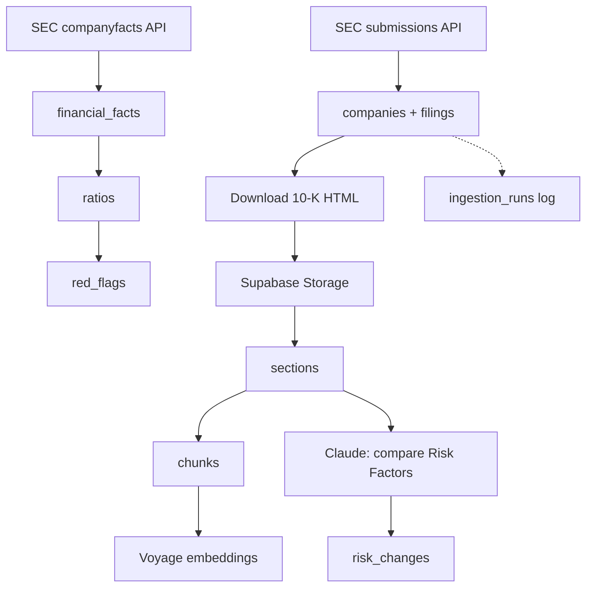
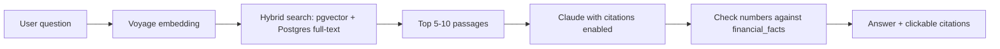

# Architecture

## Two phases

**Ahead of time (ingestion worker):** download, parse, calculate, embed and store everything for each filing, once.
**When a user clicks (app):** read stored data. The only live AI call is answering a question on the Ask screen.

## Ingestion pipeline

Order of a run for one company:

1. **Submissions:** fetch company details and filing list. Upsert `companies`; insert `filings` for the last 3 fiscal-year 10-Ks.
2. **Company facts:** fetch all XBRL facts. Keep facts for the loaded fiscal years, deduplicate, and insert into `financial_facts`.
3. **Ratios:** the ratio engine reads the company's sector profile and calculates each metric per fiscal year into `ratios`. Missing inputs → "not applicable" with a reason.
4. **Red flags:** each rule in the profile runs against the ratios. A rule that returns true writes a `red_flags` row.
5. **Documents:** download each 10-K (skip if already in Storage), save raw HTML to the `raw-filings` bucket.
6. **Sections:** the parser splits the HTML into standard items (1, 1A, 7, 7A, 8…), skipping the table of contents. Large financial-statement tables in Item 8 are skipped or simplified, since XBRL covers those numbers.
7. **Chunks:** each section is split into passages of a few hundred tokens with company, filing, section and page metadata.
8. **Embeddings:** chunks are sent to Voyage in batches; vectors are stored in `chunks.embedding`.
9. **Risk changes:** for each filing with a prior year loaded, Claude compares the two Risk Factors sections and classifies each difference as added, removed or reworded (Batch API, Haiku during development).
10. **Log:** `ingestion_runs` records start, finish, status, counts and any error.

Each step is idempotent: running it twice doesn't create duplicates.

## Question answering (Ask screen)

- Search is filtered to the selected company and fiscal years.
- The prompt tells Claude to answer only from the passages and to say what the filing doesn't state.
- Numbers in the answer are compared with `financial_facts`; mismatches are flagged, not hidden.
- Every question and answer is logged to `answers`.

## Components

| Component | Location | Runs |
| --- | --- | --- |
| SEC client (rate limiter, User-Agent, retries) | `src/sec/` | In ingestion scripts |
| Sector profiles and ratio engine | `src/metrics/` | In ingestion scripts |
| Red-flag rules | `src/metrics/rules/` | In ingestion scripts |
| 10-K parser and chunker | `src/parsing/` | In ingestion scripts |
| Embedding and search | `src/search/` | Ingestion + API routes |
| Claude calls (Q&A, risk comparison) | `src/ai/` | Ingestion + API routes |
| Ingestion entry point | `scripts/ingest.ts` | Locally, later GitHub Actions |
| Web app | `app/` (Next.js) | Vercel |
| Eval suite | `evals/` | Locally, on demand |

## Why ingestion runs as a script, not a serverless function

Downloading, parsing and embedding several large 10-Ks can take minutes. Serverless functions have execution time limits, so ingestion runs as a Node script: locally during development, then on a schedule in GitHub Actions.
